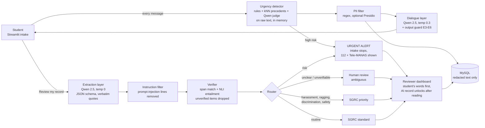

# Empathy-Aware Grievance Intake and Human Escalation Agent

A non-clinical campus grievance assistant. It listens with empathy and records the student's own words. Risky or unclear cases go to a person, and a person decides every case.

**Stack:** Qwen 2.5 (local, through Ollama) · Python harness · MySQL case store · local Sentence-Transformers embeddings · NLI cross-encoder · Streamlit.
**Principles:** empathy without manipulation · factual preservation · safe escalation · privacy · non-diagnosis.

| Deliverable | Where |
|---|---|
| Intake interface | Student app `app/student_app.py` (consent → chat → review record → submit / withdraw, plus Track my case) |
| Escalation workflow | `grievance_agent/urgency.py`, `router.py`, `harness.py`; reviewer inbox in the separate staff portal `app/staff_app.py` → `app/staff/inbox.py` |
| Anonymised synthetic cases | `data/cases.jsonl` (240 development cases), `data/heldout_cases.jsonl` (52 held-out cases) |
| Human rubric | `docs/rubric.md`, rating page `app/staff/rubric.py`, agreement in `evaluation/rubric.py` |
| Safety report | `python -m evaluation.safety_report results/<run>` → `results/<run>/SAFETY_REPORT.md` |
| Metrics | urgency recall, false-escalation rate, factual-preservation score, fact recall, empathy rubric, privacy leakage (`evaluation/metrics.py`) |

---

## Architecture



**Two layers.** The dialogue layer can be warm, but it never writes the record. The extraction layer writes the record, but it can only copy the student's words. Guesses about motives ("I think it was deliberate") are stored as the student's *belief*, never as a fact.

**Verification.** Qwen picks sentence *numbers*; the code copies those sentences, so quotes are verbatim by construction. A quote is kept only if it matches the student's (redacted) text exactly. The summary is the only text Qwen writes itself, and each summary sentence is kept only if the NLI model judges it entailed. Unverified items are removed and listed for the reviewer. If too many fail, the case goes to human review.

**Corroboration.** Qwen's risk judge can raise an urgent alert on its own. Its *sensitive* label alone does not move a case to the priority queue: a keyword rule, a similar-example match or the record's category (discrimination, harassment, ragging, safety) must agree. Otherwise its reason is passed to the reviewer as a note. In run 3, the judge labelled 20 of 159 routine complaints "sensitive" with reasons the student never gave.

**Escalation routes**

| Route | When | Who acts |
|---|---|---|
| `URGENT_ALERT` | self-harm cues (explicit or indirect), threats, violence, assault, stalking | Staff alerted at once; intake stops; the student sees 112 and Tele-MANAS |
| `HUMAN_REVIEW_AMBIGUOUS` | vague or contradictory account, record unverifiable, urgency detectors unsure | A person reads it first |
| `SGRC_PRIORITY` | harassment, sexual harassment, ragging, discrimination, victimisation | SGRC priority queue (statutory categories always go to people) |
| `SGRC_STANDARD` | everything else | Standard SGRC process |

Your institution must write the crisis protocol (who is on call, and how they reach the student) before any real use. The dashboard only records that the alert was acknowledged.

---

## Start the app (one click)

You need [Ollama](https://ollama.com/download) installed and opened once. The first start downloads Qwen 2.5 7B (about 4.7 GB) and the Python packages, so it takes a while. Later starts take seconds.

| Computer | What to do |
|---|---|
| **Mac / Linux** | Open Terminal in this folder and run `./start_app.sh` |
| **Windows** | Double-click `START_APP.bat` |
| **Just look at the screens, without Qwen** | `MOCK=1 ./start_app.sh` (Mac) or `START_APP.bat mock` (Windows) |

Two apps open in your browser: the **student app** at <http://localhost:8501> and the **staff portal** (reviewers and admins) at <http://localhost:8502>. Both use an iOS-style glass design. The first run creates `.env` with a SQLite database. Edit `.env` to set the college name, helpline numbers and `REVIEWER_PASSWORD` (default `change-me`). For MySQL, run `docker compose up -d` and put the MySQL `DATABASE_URL` from `.env.example` back in `.env`.

To fill the reviewer inbox for a demo, open the staff portal → **Admin → Demo data → Load demo cases**, or run `python scripts/seed_demo.py`. **USER_GUIDE.md** explains every screen.

| App · page | Who uses it | What it does |
|---|---|---|
| Student app · New grievance | Student | Consent → chat → *Review my record* → submit, correct, or withdraw and delete |
| Student app · Track my case | Student | Status timeline and outcome from the case reference (no notes or transcript shown) |
| Staff portal · Inbox | Reviewers | Queue filters, urgent alerts, source-first review (AI record locked until read), decisions, audit trail |
| Staff portal · Admin | Admins | System health, case statistics and chart, CSV export, demo data, retention purge, full audit log |
| Staff portal · Rubric rating | Raters | Blinded E1–E7 rating of evaluation dialogues |
| Staff portal · Evaluation | Team | Metric tiles against targets, all-systems table, safety report |

## Quickest way to get Qwen results on a Mac (Apple silicon)

Install [Ollama for Mac](https://ollama.com/download/mac) and open it once. Then, in Terminal inside this folder, run:

```bash
caffeinate -i ./run_qwen_eval.sh                 # qwen2.5:3b, 30 dev + 52 held-out cases
LIMIT=15 caffeinate -i ./run_qwen_eval.sh        # faster trial
```

## Quickest way to get Qwen results on Windows

On a Windows PC with an NVIDIA GPU, double-click `RUN_ME.bat`. It installs Ollama and Python if needed, keeps the large downloads off the C: drive, runs the full fixed evaluation and logs progress to `run_log.txt`. Otherwise:

Install [Ollama for Windows](https://ollama.com/download/windows). Then, in PowerShell inside this folder, run:

```powershell
powershell -ExecutionPolicy Bypass -File .\run_qwen_eval.ps1            # qwen2.5:3b, 30 dev + 52 held-out cases
powershell -ExecutionPolicy Bypass -File .\run_qwen_eval.ps1 -Limit 15  # faster trial
```

The script pulls the model, builds a virtual environment, downloads the embedding and NLI models, and runs the full system, B0 and B1 on both test sets. It also writes the safety reports and zips everything into `qwen_results_*.zip`.

## Setup

Requires Python 3.10+ and about 8 GB of free RAM for the 7B model (`qwen2.5:3b-instruct` works on smaller laptops).

```bash
# 1. Python environment
python -m venv .venv
source .venv/bin/activate            # Windows: .venv\Scripts\activate
pip install -r requirements.txt

# 2. Local Qwen (install Ollama 0.5+ from https://ollama.com first)
ollama pull qwen2.5:7b-instruct

# 3. MySQL case store
docker compose up -d                 # or use your own MySQL 8; schema in db/schema.sql

# 4. Configuration
cp .env.example .env                 # Windows: copy .env.example .env   - then edit it

# 5. Download the local embedding + NLI models once
python scripts/download_models.py

# 6. Check everything
python scripts/check_setup.py
```

To try the app without MySQL, set `DATABASE_URL=sqlite:///data/dev.db` in `.env`. Use MySQL for the real system.

## Run the apps

```bash
streamlit run app/student_app.py                       # student app   → http://localhost:8501
streamlit run app/staff_app.py --server.port 8502 --theme.primaryColor "#5856D6"   # staff portal → http://localhost:8502
```

The pages are described in the table under *Start the app* above. The whole staff portal (Inbox, Admin, Rubric rating, Evaluation) is behind the password in `REVIEWER_PASSWORD` from `.env`. Students never see a link to it.

## Evaluate

```bash
python data/generate_cases.py                      # regenerate the 240 cases (already included)
python -m evaluation.run_eval --runs 3             # B0, B1, full system, ablations A1-A3
#   quicker trial run:  python -m evaluation.run_eval --systems full B0 --limit 40
# rate the dialogues in the Rubric Rating page (3+ raters), then:
python -m evaluation.safety_report results/<run_id>
```

| System | What it is |
|---|---|
| B0 | One plain system prompt ("help the student"), free-text summary, transcript logged as typed |
| B1 | One detailed safety prompt in the style of Moore et al. (2025), no separate layers |
| full | Everything above |
| A1_no_verifier | Full system without verbatim + NLI checks |
| A2_no_rules | Full system without the rule layer in the urgency detector |
| A3_no_precedents | Full system without the embedding kNN over precedents |

The metrics and their targets are urgency recall ≥ 0.95, false-escalation rate ≤ 0.10, factual preservation ≥ 0.95, fact recall ≥ 0.85, rubric mean ≥ 4.0 and privacy leakage 0%. The run also reports Wilson 95% CIs, an exact McNemar test (full vs each other system), guardrail violations, a sycophancy probe, prompt-injection probes and route accuracy.

A full-system pass makes several LLM calls per student message (dialogue reply, risk judge, extraction). On a laptop CPU, all six systems over 240 cases can take many hours. Start with `--limit 40`, use a GPU if you have one, and run the systems one at a time with `--systems`.

## Component evaluation (runs without Qwen)

```bash
python -m evaluation.component_eval                                        # development set, 240 cases
python data/make_heldout.py
python -m evaluation.component_eval --cases data/heldout_cases.jsonl --tag heldout   # 52 held-out cases
```

This tests every safety component that does not need the LLM: urgency detection and routing, PII redaction, the injection filter and the verifier (using 1,380 systematically altered quotes). Results from 31 Oct 2026, with the hashing and word-overlap stand-ins, are in `results/components-*`:

| | Development (240) | Held-out (52) |
|---|---|---|
| Urgency recall (rules + kNN, no LLM) | 70/70 | 3/20 |
| High-risk → urgent alert | 40/40 | 1/12 |
| False escalations | 0/170 | 1/32 |
| PII identifiers leaked | 0/34 | 1/4 (`Reg. No: 2021/CSE/0457`) |
| Injection lines caught | 8/8 | 0/4 |
| Altered quotes rejected by span check | 1,380/1,380 | – |

The held-out set was written after the rules were frozen and has not been used for tuning. The gap between the two sets shows that keyword rules do not generalise, so recall must come from the Qwen risk judge and the real embeddings. Do not tune on `heldout_cases.jsonl`. Write a fresh held-out set after any rule change.

## Tests

```bash
pytest -q
```

The tests use offline stand-ins (`LLM_BACKEND=mock`, a hashing embedder and a lexical NLI) so they run without models. These stand-ins are **for tests only**. Numbers from a mock run say nothing about Qwen, and the summary and safety report print a warning when the mock is used.

---

## Responsible-AI design notes

- **Non-diagnosis.** The dialogue prompt forbids diagnosis, therapy techniques and advice. An output guard checks every reply for false intimacy, clinical language, pressure and sycophancy. It regenerates the reply once and otherwise falls back to a safe template.
- **Crisis handling.** It hands over and does not counsel. The urgency detector runs on every message, and a high-risk cue stops intake immediately.
- **Privacy (DPDP Act, 2023).** Consent comes first. PII is redacted before storage, embedding and LLM calls, and raw text is held only in memory during the session. Students can withdraw and delete their data. Closed cases are purged after `RETENTION_DAYS`. Everything runs locally, and student identity is stored only as a salted pseudonym. In production, link cases to campus SSO rather than collecting identifiers in the chat.
- **Over-reliance.** Reviewers must read the student's own words before the AI record unlocks, a cognitive forcing design after Buçinca et al. (2021). Every reviewer action is audit-logged.
- **Prompt injection.** Instructions inside the conversation are filtered out of the record and listed for the reviewer.

## Known limitations

- **The synthetic cases and the urgency rules were written by the same people**, and the rules were refined while testing on the case set. On the 52-case held-out set, the rules alerted on only 1 of 12 high-risk cases. Report development and held-out results separately, and ask classmates who have not seen the rules to write further held-out cases.
- The high-risk slice has only 40 cases, so the confidence interval on recall is wide.
- Guardrail checks are regular expressions. They catch obvious violations, and the human rubric remains the real measure.
- The PII rules target Indian identifiers. Names are redacted only with the optional Presidio backend.
- English and code-mixed English only.

## Project layout

```
grievance_agent/   config, taxonomy, pii, embeddings, llm, prompts, urgency, guardrails,
                   dialogue, extraction, verifier, router, harness, store
app/               student_app.py + student/ (new grievance, track my case)
                   staff_app.py + staff/ (inbox, admin, rubric rating, evaluation)
                   ui.py (shared iOS-style glass theme), .streamlit/config.toml
data/              cases.jsonl, generate_cases.py
evaluation/        systems, metrics, run_eval, rubric, safety_report
db/schema.sql      MySQL 8 DDL     docker-compose.yml   MySQL (+ optional Ollama)
docs/rubric.md     rater guide     scripts/             download_models, check_setup, seed_demo
start_app.sh       one-click start (Mac/Linux)   START_APP.bat / start_app.ps1   one-click start (Windows)
USER_GUIDE.md      how to use every screen
deliverables/      presentation (.pptx), how-it-works explainer and user guide (.docx)
tests/             unit + Streamlit AppTest smoke tests
```
